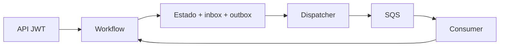

# Oficina — os Service / Fase 4

Repositório independente: https://github.com/Lucas-Rodrigues-Camargo/pos-tech-fiap-software-architecture-os-service

## Responsabilidade e arquitetura

Clientes, abertura/histórico da OS e orquestração da Saga em PostgreSQL próprio.



Nenhum serviço acessa o banco de outro. Gravações atômicas persistem documento de estado, inbox, histórico e outbox com versão otimista. Consumidores deduplicam por eventId; reenvios da outbox preservam esse identificador.

## APIs

OpenAPI: /openapi/v1.json (Employee). Health: /health. Readiness de banco: /ready.

- PUT /api/customers/{cpf}: {name, active}, somente Employee.
- POST /internal/auth/customers: {cpf}, autenticado por X-Internal-Key para a Lambda.
- POST /api/orders: {orderId, cpf, plate, description}.
- GET /api/orders/{id}.
- POST /api/orders/{id}/cancel.

Comandos HTTP exigem Idempotency-Key (UUID). JWT HS256 valida issuer OficinaMecanica, assinatura, validade e audience OficinaMecanica.Customer ou OficinaMecanica.Admin. Roles: Customer, Admin e User. Cliente só consulta/altera CPF proprietário; funcionários usam a autenticação interna anterior.

## Executar e testar

Requisitos: .NET 10, Docker, PostgreSQL e LocalStack SQS/DynamoDB. O README raiz phase4-e2e explica como subir os containers e executar o BDD completo.

Configure variáveis com os nomes de config/environment.example.json. Não use placeholders em produção.

```powershell
$env:Jwt__Key = 'local-only-secret-with-at-least-32-bytes'
# Configure banco próprio e URLs das filas antes de executar.
dotnet run --project src --urls http://localhost:8081
$env:TEST_POSTGRES = 'Host=localhost;Port=5541;Database=os;Username=postgres;Password=local-os-only'
$env:TEST_AWS_ENDPOINT = 'http://localhost:4566'
dotnet test tests/Tests.csproj -c Release --settings coverage.runsettings --collect:"XPlat Code Coverage"
python scripts/verify_coverage.py
docker build -t oficina-os:local .
```

Storage tests exigem base isolada de teste e criam/removem sua própria tabela Dynamo. O CI exige 80% de cobertura de linhas; exclui apenas código gerado em obj. Evidências Cobertura/OpenCover são artefatos do Actions. Testes cobrem domínio, workflow, persistência, filas, API e autorização.

## Saga e falhas

Escolha: orquestração no OS para decisão central e histórico auditável. Fluxo: abertura → diagnóstico → orçamento → aprovação → pagamento confirmado → reparo → finalização.

Cancelamento primeiro solicita CancelJob. Após JobCanceled, solicita CancelBudget. Se houve pagamento, Billing persiste RefundPending e publica RefundPayment; só após estorno confirmado emite BudgetCanceled. A OS só fica Canceled após ambas as compensações. Reparos físicos iniciados exigem ManualIntervention. Estorno falho retenta com chave idempotente; mensagens persistem na outbox/inbox e DLQ após cinco tentativas. OS tem watchdog para etapas anteriores ao reparo: Saga__TimeoutMinutes (1440 por padrão).

Envelope v1: id, orderId/sagaId, type, destination, correlationId, data e version. CorrelationId passa entre serviços e logs JSON; cada evento mantém a referência à OS. Nunca confirme pagamento com dados enviados pelo cliente.

## Infraestrutura e deploy

infra/ provisiona fila/DLQ, ECR, Pod Identity IAM e RDS privado com senha gerenciada pelo Secrets Manager. EKS, VPC e Datadog continuam no repositório Kubernetes.

- Secrets GitHub: AWS_DEPLOY_ROLE_ARN, TF_VARS_JSON, SERVICE_CONFIG_JSON, SONAR_TOKEN.
- Variables: TF_STATE_BUCKET, EKS_CLUSTER, AWS_REGION, SONAR_HOST_URL.
- TF_VARS_JSON: cluster_name, region, namespace (oficina-phase4), vpc_id, private_subnet_ids, workload_security_group_ids dos nodes.
- Backend S3: bucket pré-existente/versionado, state separado por serviço, criptografia e lockfile.
- Ative INFRA_ENABLED=true para Provision infrastructure; depois preencha SERVICE_CONFIG_JSON com outputs reais e senha do RDS, usando TLS.
- Ative DEPLOY_ENABLED=true para deploy automático após merge na main. CI testa, verifica cobertura e Terraform e constrói Docker; deploy publica imagem imutável e aguarda rollout.
- SonarQube roda quando SONAR_TOKEN está configurado; sem credencial a análise externa é omitida e isso deve ser resolvido antes da entrega.
- Proteção de main com PR/checks é configuração externa do GitHub.

Manifestos incluem Deployment, Service, ServiceAccount e HPA, probes, limites e usuário não root. Kubernetes Secret injeta configuração. Labels/anotações Datadog coletam logs. Configure Ingress/TLS público no cluster para APIs e webhook.

## Mercado Pago e limites

Billing precisa de credenciais Mercado Pago sandbox para validar pagamentos reais de teste; E2E local usa simulador HTTP.

No cenário acadêmico, inbox/histórico ficam no documento. Em alto volume, arquive os registros e substitua scans da outbox por índices/filas dedicadas para respeitar o limite de item do DynamoDB. A migração dos dados anteriores exige exportação e reconciliação; não é executada automaticamente.

Para simplificar a entrega acadêmica, foi adotado um único ambiente (produção). Nenhum recurso AWS é provisionado durante testes locais.

