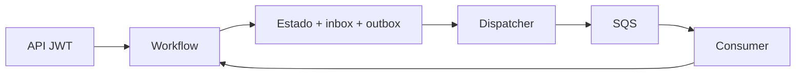

# Oficina — os Service / Fase 4

Repositório independente: https://github.com/Lucas-Rodrigues-Camargo/pos-tech-fiap-software-architecture-os-service

Consulte [infraestrutura existente](docs/aws-existing-infra.md), [matriz dos requisitos](docs/requirements-matrix.md), [contratos](docs/contracts.md) e [evidências geradas](docs/verification.json).

## Responsabilidade e arquitetura

Clientes, abertura/histórico da OS e orquestração da Saga em PostgreSQL próprio.



Nenhum serviço acessa o banco de outro. Gravações atômicas persistem documento de estado, inbox, histórico e outbox com versão otimista. Consumidores deduplicam por eventId; reenvios da outbox preservam esse identificador.

## APIs

OpenAPI: /openapi/v1.json (Employee). Health: /health. Readiness de banco: /ready.

- PUT /api/customers/{cpf}: {name, active}, somente Employee.
- POST /internal/auth/customers: {cpf}, autenticado por X-Internal-Key para a Lambda.
- POST /api/orders: {orderId, cpf, plate, description}.
- GET /api/orders/{id}.
- POST /api/orders/{id}/cancel.

Comandos HTTP exigem Idempotency-Key (UUID). JWT HS256 valida issuer OficinaMecanica, assinatura, validade e audience OficinaMecanica.Customer ou OficinaMecanica.Admin. Roles: Customer, Admin e User. Cliente só consulta/altera CPF proprietário; funcionários usam a autenticação interna anterior.

## Executar e testar

Requisitos: .NET 10, Docker, PostgreSQL e LocalStack SQS/DynamoDB. O README raiz phase4-e2e explica como subir os containers e executar o BDD completo.

Configure variáveis com os nomes de config/environment.example.json. Não use placeholders em produção.

```powershell
$env:Jwt__Key = 'local-only-secret-with-at-least-32-bytes'
# Configure banco próprio e URLs das filas antes de executar.
dotnet run --project src --urls http://localhost:8081
$env:TEST_POSTGRES = 'Host=localhost;Port=5541;Database=os;Username=postgres;Password=local-os-only'
$env:TEST_AWS_ENDPOINT = 'http://localhost:4566'
dotnet test tests/Tests.csproj -c Release --settings coverage.runsettings --collect:"XPlat Code Coverage" --logger trx
python scripts/verify_coverage.py
python scripts/record_evidence.py
python -m unittest discover -s scripts -p 'test_*.py'
docker build -t oficina-os:local .
```

Storage tests exigem um PostgreSQL isolado para teste; não acessam DynamoDB. O CI exige 80% de cobertura de linhas; exclui apenas código gerado em obj. Evidências Cobertura/OpenCover são artefatos do Actions. Testes cobrem domínio, workflow, persistência, filas, API e autorização.

## Saga e falhas

Escolha: orquestração no OS para decisão central e histórico auditável. Fluxo: abertura → diagnóstico → orçamento → aprovação → pagamento confirmado → fila liberada → início pelo funcionário → reparo → finalização.

Cancelamento primeiro solicita CancelJob. Após JobCanceled, solicita CancelBudget. Se houve pagamento, Billing persiste RefundPending e publica RefundPayment; só após estorno confirmado emite BudgetCanceled. A OS só fica Canceled após ambas as compensações. Reparos físicos iniciados exigem ManualIntervention. Estorno falho retenta com chave idempotente; mensagens persistem na outbox/inbox e DLQ após cinco tentativas. OS tem watchdog para etapas anteriores ao reparo: Saga__TimeoutMinutes (1440 por padrão).

Envelope v1: id, orderId/sagaId, type, destination, correlationId, causationId, traceParent, data e version. InboxFingerprints detecta o mesmo id reutilizado com outro comando/payload, no escopo da OS. Eventos tardios não reabrem trabalho cancelado. CorrelationId passa entre serviços e logs JSON; cada evento mantém a referência à OS. Nunca confirme pagamento com dados enviados pelo cliente.

## Deploy em infraestrutura existente

O caminho padrão pressupõe EKS, ECR, bancos, SQS e identidades já disponíveis. Siga o contrato e as permissões em [aws-existing-infra.md](docs/aws-existing-infra.md). A aplicação não precisa de permissão para criar recursos AWS.

Configure AWS_DEPLOY_ROLE_ARN, SERVICE_CONFIG_JSON, SONAR_TOKEN, EKS_CLUSTER, AWS_REGION e SONAR_HOST_URL. ECR_REPOSITORY permite usar o repositório ECR já existente. INGRESS_HOST e TLS_SECRET habilitam a aplicação do Ingress/TLS. O deploy só roda com DEPLOY_ENABLED=true, após testes, cobertura e quality gate.

O pipeline valida configuração antes de contactar AWS, publica a imagem com tag do commit e aguarda rollout. Placeholders, filas trocadas, credenciais AWS estáticas, endpoints locais e TLS inadequado são rejeitados. Secrets nunca são impressos.

infra/ mantém a referência Terraform para os recursos do serviço. O provisionamento é opcional: sem execução automática em push, só roda manualmente com confirm_apply=true e INFRA_ENABLED=true. Não é uma etapa obrigatória para usar infraestrutura existente.

Manifestos incluem Deployment, Service, ServiceAccount, HPA, probes, limites e usuário não root. A role do pod deve estar previamente associada ao ServiceAccount via Pod Identity. Logs JSON e traces OTLP são enviados ao Datadog existente. A proteção de main/PR e o acesso OIDC/RBAC são configurações externas.

## Mercado Pago e limites

Billing precisa de credenciais Mercado Pago sandbox para validar pagamentos reais de teste; E2E local usa simulador HTTP.

No cenário acadêmico, inbox/histórico ficam no documento. Em alto volume, arquive os registros e substitua scans da outbox por índices/filas dedicadas para respeitar o limite de item do DynamoDB. A migração dos dados anteriores exige exportação e reconciliação; não é executada automaticamente.

Para simplificar a entrega acadêmica, foi adotado um único ambiente (produção). Nenhum recurso AWS é provisionado durante testes locais.

