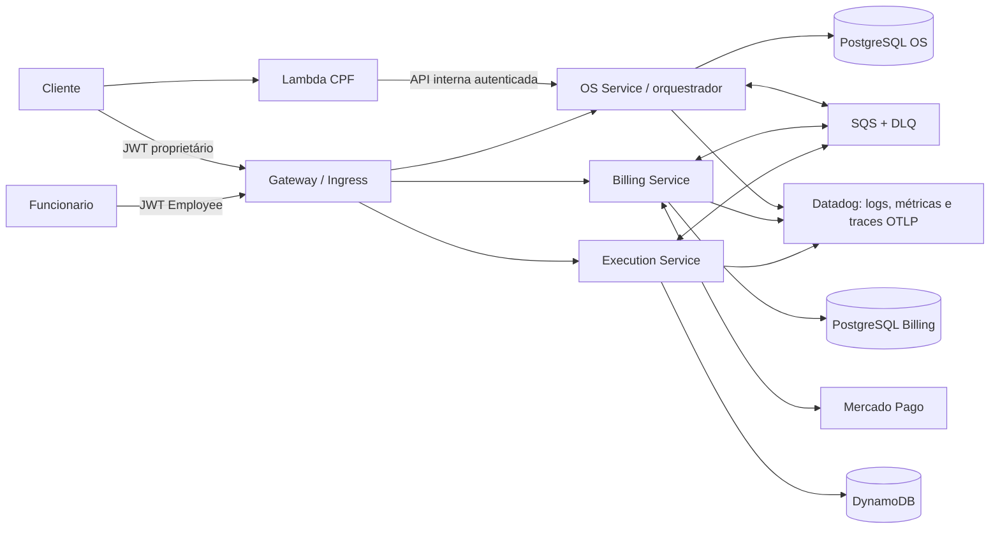
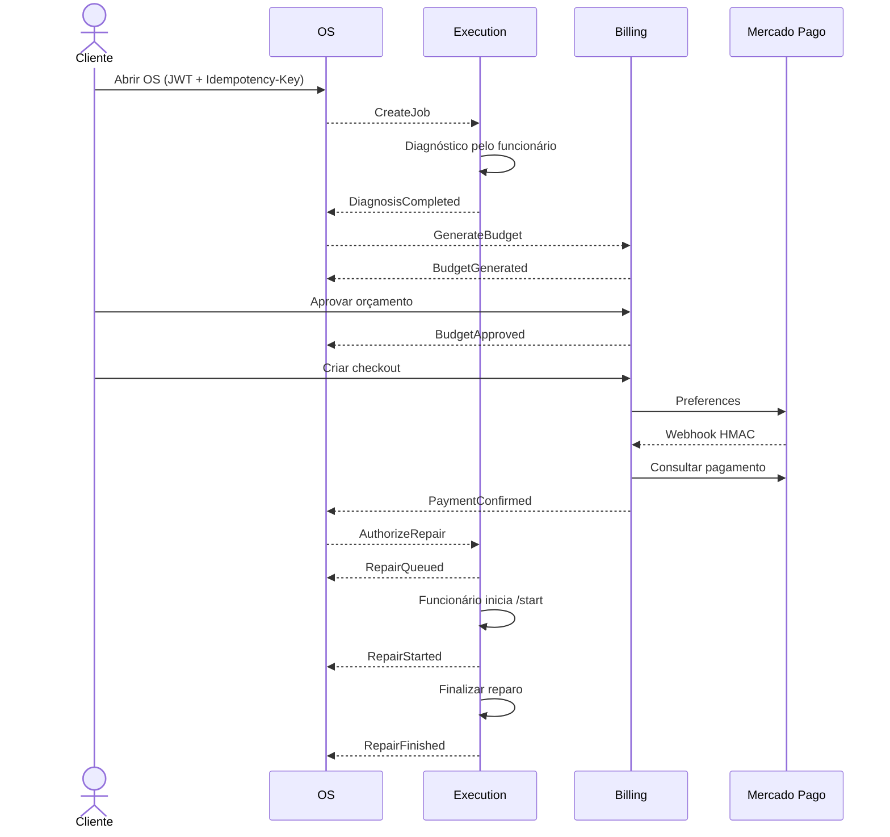

# Fase 4 — arquitetura implementada

Fonte: SOAT - Fase 4 - Tech challenge.pdf fornecido pelo usuário. As decisões AWS, .NET, PostgreSQL/DynamoDB, SQS e Saga orquestrada são escolhas do projeto.

## Componentes

Cada serviço tem código, testes, Dockerfile, Terraform, Kubernetes e pipelines próprios. As pastas estão dentro do workspace principal, mas cada uma tem seu próprio Git/remoto; o Git pai as ignora. Não há dependências ProjectReference entre serviços.

- OS: https://github.com/Lucas-Rodrigues-Camargo/pos-tech-fiap-software-architecture-os-service
- Billing: https://github.com/Lucas-Rodrigues-Camargo/pos-tech-fiap-software-architecture-billing-service
- Execution: https://github.com/Lucas-Rodrigues-Camargo/pos-tech-fiap-software-architecture-execution-service

## Sequência

## Saga e consistência

Estado, inbox, outbox e histórico são persistidos atomicamente por agregado. PostgreSQL usa jsonb e compare-and-swap por versão; DynamoDB usa PutItem condicional. Cada serviço contém apenas o adaptador do banco que realmente utiliza. A API só confirma o comando depois da persistência. O fingerprint da inbox rejeita reutilização da chave com dados diferentes; causationId preserva a origem de cada evento. O dispatcher envia antes de retirar da outbox; falha no save permite duplicata, deduplicada pela inbox.

O cancelamento compensa execução antes de cobrança, evitando estorno de trabalho físico que não pode ser cancelado. Se o trabalho já começou, o estado é ManualIntervention. Billing persiste RefundPending antes de chamar o provedor. RefundPayment retenta com X-Idempotency-Key; falha nunca confirma cancelamento. Após JobCanceled e BudgetCanceled, a OS fica Canceled. Timeouts das etapas anteriores ao reparo iniciam compensação; DLQ retém falhas repetidas.

Limites acadêmicos: inbox/histórico embutidos exigem arquivamento antes de alto volume; a outbox Dynamo usa scan paginado. Itens Dynamo têm limite de tamanho. Cobranças duplicadas diferentes exigem revisão; criar preferências de checkout não garante unicidade da cobrança. Não há migração automática de dados da Fase 3.

## Segurança e observabilidade

JWT valida issuer, audiences, assinatura e validade. CPF do cliente é comparado com o proprietário. A Lambda consulta clientes exclusivamente por API interna autenticada. Não há consulta de banco entre serviços.

Webhook verifica HMAC SHA256, request ID, timestamp e consulta autoritativa no Mercado Pago. Valor, moeda BRL e referência da OS devem coincidir. Tokens sandbox e chaves são configuração externa, nunca código versionado.

Logs JSON propagam correlationId e orderId. OpenTelemetry instrumenta HTTP e processamento de eventos, transportando traceparent no envelope e exportando OTLP ao Datadog Agent. Terraform do cluster foi estendido para receiver OTLP, métricas, dashboard e alerta dos três serviços. Referência: https://docs.datadoghq.com/opentelemetry/setup/otlp_ingest_in_the_agent/

## Testes e evidências

Os testes incluem APIs HTTP in-process, autorização e propriedade, workflow, timeout, retries de estorno, idempotência com fingerprint, eventos tardios, PostgreSQL real em container, DynamoDB via LocalStack e consumidores/publicação SQS. As evidências numéricas são geradas em docs/verification.json a partir de TRX e Cobertura. O gate de linhas exige 80%; apenas código gerado em obj é excluído.

BDD Gherkin com pytest-bdd executa três hosts separados e bancos/filas reais de teste: sucesso com pagamento, rejeição com compensação e cancelamento pago com estorno confirmado. Apenas Mercado Pago é um simulador HTTP local. Há workflow manual Distributed BDD no OS Service, com checkout dos três serviços. Para repositórios privados, configurar CROSS_REPO_READ_TOKEN.

## Implantação sobre infraestrutura existente

O caminho padrão usa cluster, bancos, filas, ECR e identidades já existentes. Não é necessário executar Terraform apply. Cada serviço documenta o contrato em docs/aws-existing-infra.md e valida SERVICE_CONFIG_JSON localmente antes de qualquer acesso de deploy à AWS.

1. Conferir o contrato de recursos, acesso de rede e Pod Identity/RBAC.
2. Configurar SERVICE_CONFIG_JSON, AWS_DEPLOY_ROLE_ARN, EKS_CLUSTER, ECR_REPOSITORY e região.
3. Configurar SonarQube e ativar DEPLOY_ENABLED quando o ambiente estiver pronto.
4. O merge na main valida testes, cobertura, configuração e quality gate; publica imagem imutável e aguarda rollout.
5. INGRESS_HOST/TLS_SECRET permitem aplicar o Ingress ao controller existente.
6. Configurar Lambda com CUSTOMER_API_URL, INTERNAL_API_KEY e JWT_KEY coerentes com o OS.
7. Validar Mercado Pago sandbox e observabilidade no ambiente do grupo; configurar proteção de main e PRs.

O Terraform é uma referência opcional para reproduzir a infraestrutura. Nos serviços, o workflow de provisionamento não roda em push e exige confirmação manual explícita. A implementação foi validada localmente, não como deploy ativo nem como pagamento sandbox externo.

## Itens que dependem do grupo

Configuração da infraestrutura AWS existente, segredos Mercado Pago sandbox, SonarQube/Datadog, DNS/TLS, política de branch no GitHub, identificação dos participantes e gravação/publicação do vídeo até 15 minutos. O PDF de arquitetura gerado é documentação técnica; a entrega final precisa dessas evidências reais.

## Decisões

- ADR-004: três bounded contexts reduzem acoplamento entre atendimento, financeiro e produção; preservar domínio existente sem migrar a base automaticamente.
- ADR-005: Saga orquestrada mantém a ordem das compensações explícita e auditável.
- ADR-006: PostgreSQL em OS/Billing pela durabilidade e transações; DynamoDB em execução para estado documental e escala independente.
- ADR-007: SQS, inbox/outbox e versão otimista fornecem entrega pelo menos uma vez sem prometer exactly-once.
